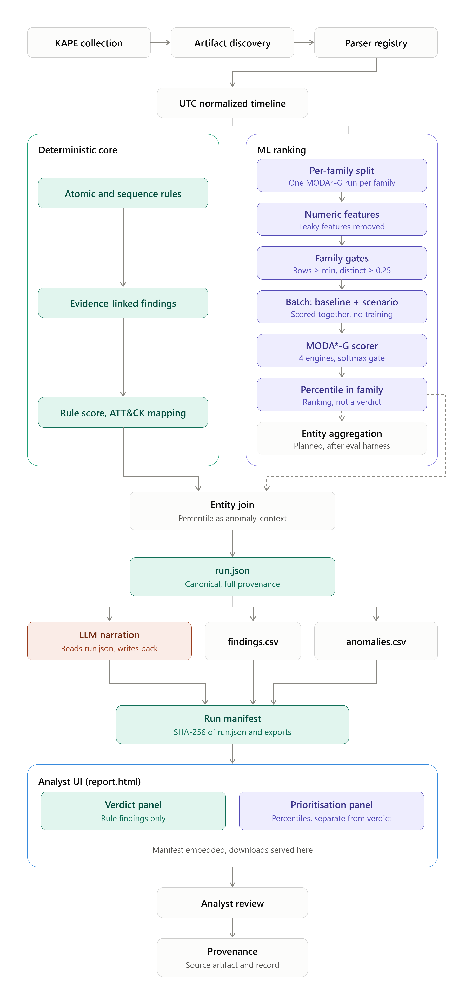
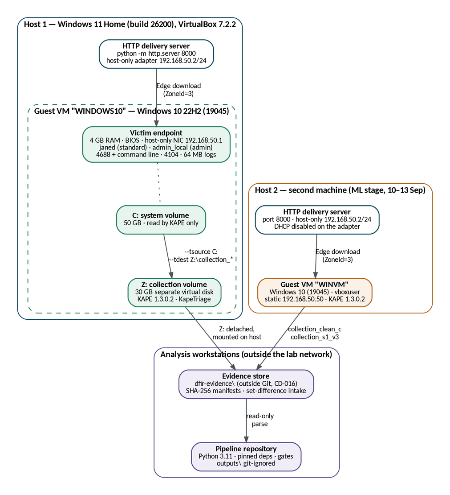
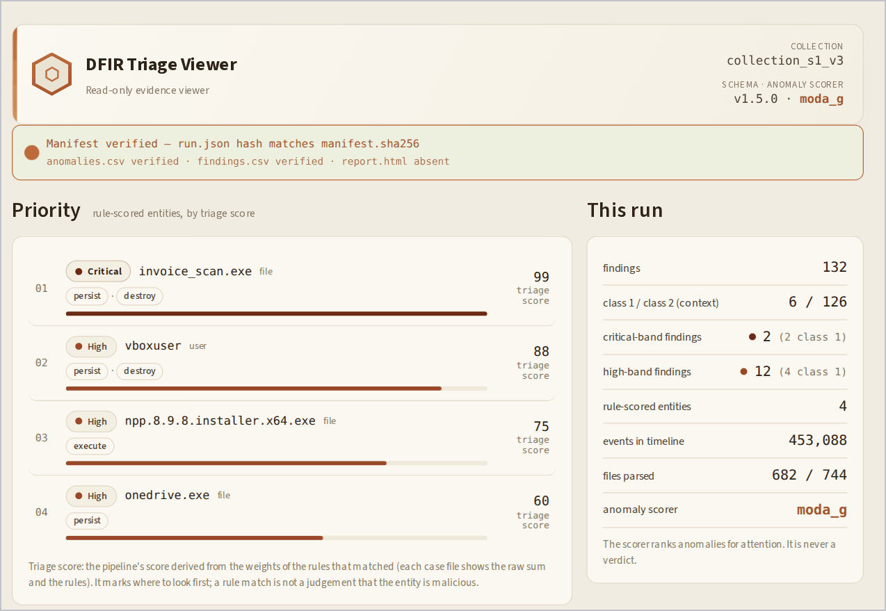
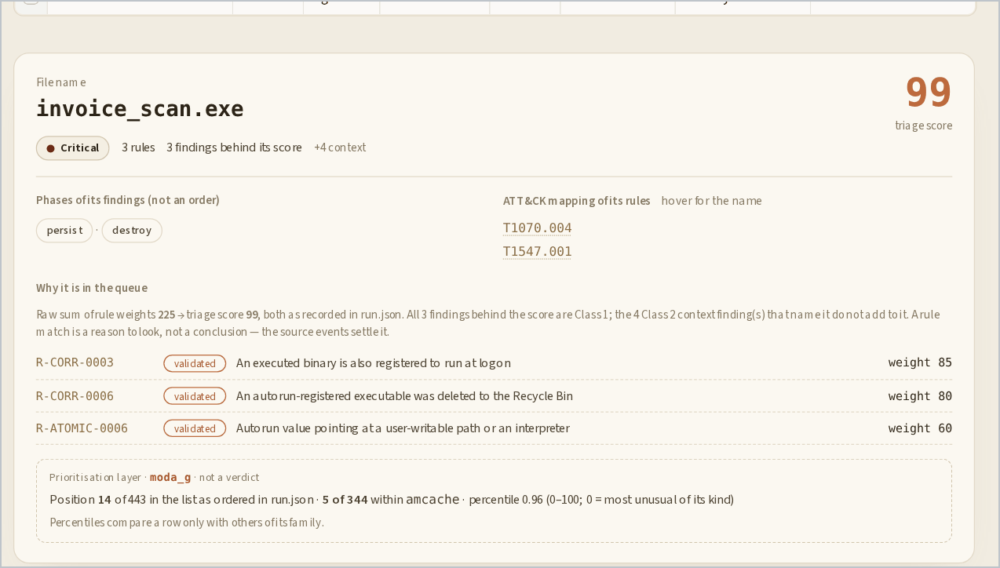
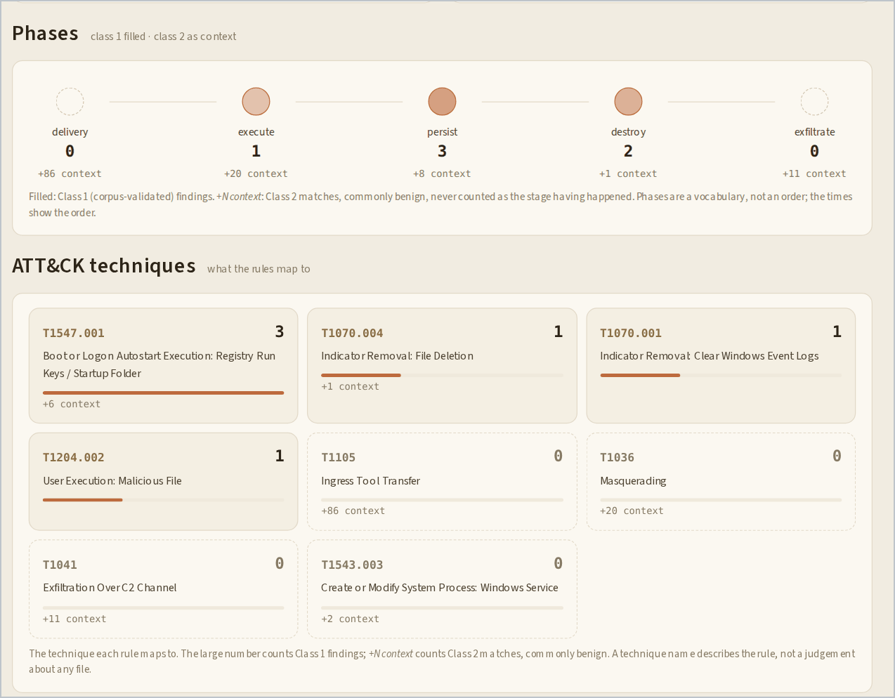
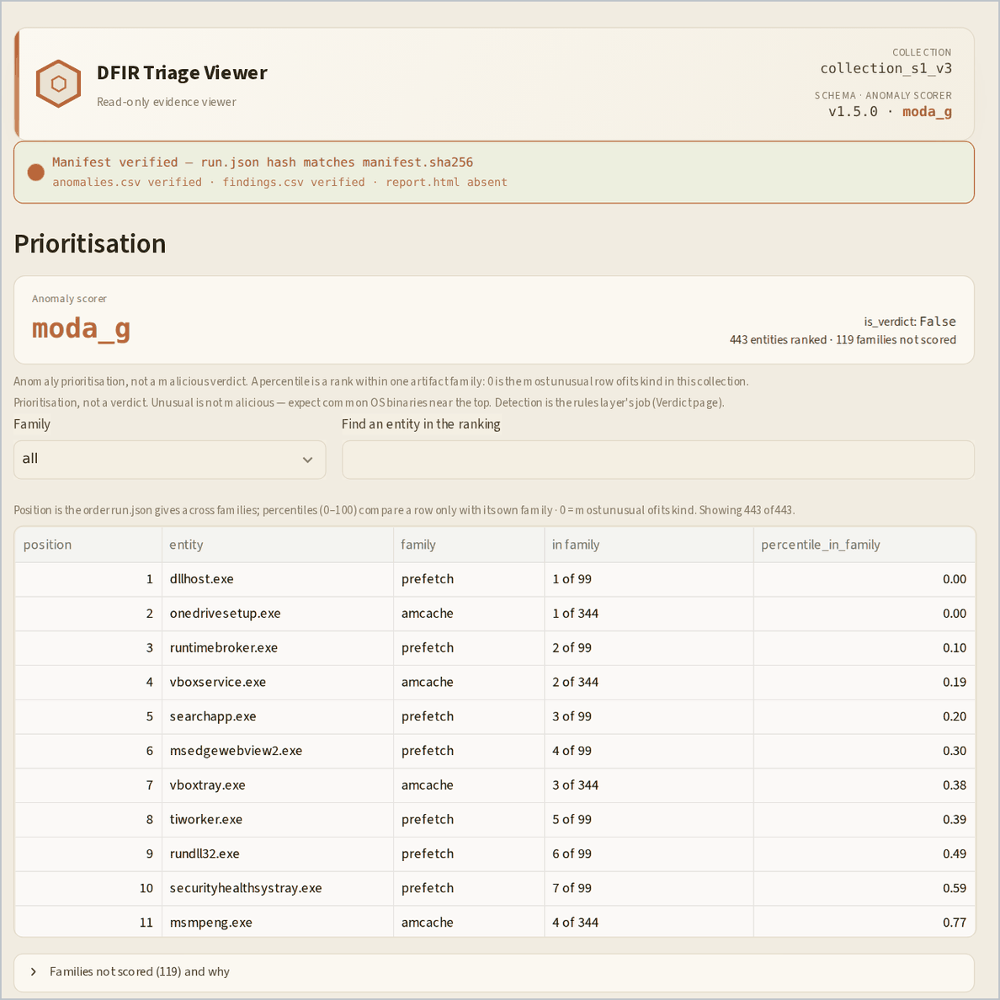
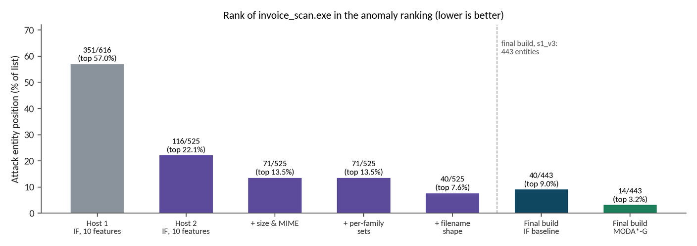

# DFIR Triage Pipeline

**Offline triage for Windows incident response.** It turns a KAPE collection into
a provenance-preserving UTC timeline, detects attacker behaviour with declarative
correlation rules, ranks what to look at first, and seals every result so it can be
checked. A read-only viewer presents the result to the analyst.

*Final Year Project — Computer Science (Cybersecurity), University of Sciences and
Arts in Lebanon, September 2026.*
*Youssef Najjar · Karim Fadlallah — supervised by Marwa Deeb.*

---

## What it does

- **Parses 24 Windows artifact types** — event logs, registry hives, Prefetch,
  Amcache, SRUM, `$MFT`, the USN journal, browser history, LNK files, jump lists,
  the Recycle Bin and more — into one UTC timeline in which **every event names the
  file and record it came from**.
- **Detects with 30 YAML rules**: 23 single-event rules and 7 correlation rules that
  link evidence from different artifacts only when it shares an identity (the same
  program, account or source address) — never on closeness in time alone.
- **Separates proven from unproven.** Rules measured against clean and attack
  collections (*Verdict*) are the only ones allowed to raise a program's or an
  account's triage score; the rest (*Context*) are shown in full but never scored.
- **Ranks unusual programs** with an unsupervised anomaly layer (MODA\*-G by default,
  Isolation Forest kept as an alternative), fitted against a clean baseline of the
  same machine. It orders the analyst's reading; it never raises an alert.
- **Seals the output.** One canonical `run.json`, with `findings.csv`,
  `anomalies.csv` and `report.html` derived from it, all covered by a SHA-256
  manifest. The same input produces byte-identical output.
- **Adds an optional plain-English briefing** from a local LLM (qwen2.5:7b on
  Ollama). The model never sees rule IDs, and deterministic code checks every
  sentence against the record before anything is shown.
- **Shows it in a read-only viewer** (Streamlit) that verifies the manifest first,
  keeps verdict, context, ranking and briefing in separate panels, and treats every
  value from the evidence as hostile input.

## Architecture



*The system architecture as presented in the final report. Two details have
moved on since the figure: per-program aggregation of the anomaly ranking is
implemented (each program keeps its most unusual row), and the analyst UI is the
Streamlit viewer in `viewer/`, with `report.html` as a static reference report.*

| Stage | What happens | Where |
|---|---|---|
| Collect | KAPE copies the artifacts off the machine or image | outside this repo |
| Parse | 24 parsers emit frozen, UTC-only events with source file and record locator | `dfir_triage_pipeline/parsers/` |
| Detect | Atomic and correlation rules produce evidence-linked findings | `rules/`, `dfir_triage_pipeline/core/engine.py` |
| Score | Findings roll up per program and account; only validated rules score | `core/entity_score.py` |
| Rank | Per-family anomaly ranking against a same-machine baseline | `anomaly.py`, `features.py`, `_scorers_moda.py` |
| Seal | `run.json` + derived exports + SHA-256 manifest | `core/run_json.py`, `core/manifest.py` |
| Explain | Optional checked LLM briefing, written before the manifest is hashed | `core/narration.py`, `core/citations.py` |
| View | Read-only analyst viewer | `viewer/` |

## Laboratory and evidence

Two isolated VirtualBox hosts produced five KAPE collections: three clean
baselines and two runs of the same attack chain (HTTP delivery, execution,
Run-key persistence, Security-log clearing). The payload was a benign 4,608-byte
stand-in; no real malware was run. Evidence stays outside the repository and every
collection is verified against SHA-256 manifests ([`groundtruth/`](groundtruth/)).



*Laboratory and evidence-flow topology (final report, Figure 6). Details:
[`docs/lab-setup.md`](docs/lab-setup.md).*

## The viewer

The viewer opens one sealed run, checks its SHA-256 manifest before showing
anything, and keeps confirmed detections, background context, the anomaly ranking
and the AI briefing in separate panels. It has no write path.



*Overview of the lab scenario: the manifest check, the priority queue by triage
score, and the run's facts (final report, Figure 66).*



*A case file: the validated rules behind a score, their weights, and the anomaly
layer's separate, non-verdict position (final report, Figure 69).*

<details>
<summary>More screens: attack phases, ATT&CK techniques, and the anomaly ranking</summary>



*Attack phases and ATT&CK techniques: only validated (Class 1) findings fill a
phase; context findings show as "+N context" (final report, Figure 67).*



*The anomaly ranking, labelled "not a verdict": ordinary Windows programs lead
it, which is why detection stays with the rules (final report, Figure 63).*

</details>

## Results

**Lab scenario (`s1_v3`: download → execution → Run-key persistence → log clearing).**
- The attack binary is the top-scored program, **99 (critical)**. No clean
  collection produces a critical program; clean hosts top out at 86.
- The anomaly layer ranks it **14th of 443** with MODA\*-G, against 40th with
  Isolation Forest, with a false-alarm rate of 4.8% on a clean host.
- On the first lab host, clearing the Security log destroyed at least 50 findings
  that the clean baselines show the evidence would otherwise have supported, yet
  50 of the 53 scenario findings survived on other artifacts (final report, §5.4).



*How the attack binary's rank improved through the ML stage, ending at 14th of
443 with MODA\*-G (final report, Figure 94).*

**A real Windows Server 2022 break-in** (a public research image ending in Petya
ransomware, never seen during development; about 2.07 million events):
- **13 of 19** attacker steps produced a finding, and **16 of the 22** findings are
  tied to the attack.
- It found **how the attacker got in**: one successful logon 0.6 s after the last of
  52,426 failed attempts from the same address.
- Grouping remote logons by source address cut that noise from **807 alerts to 3**.
- Ranked against another machine's baseline (an indicative experiment), MODA\*-G
  reached **ROC AUC 0.94** for the attack programs, against 0.84 for Isolation Forest.

These are measurements on specific cases, not a general accuracy claim. Details:
[`docs/evidence/srv22-analysis.md`](docs/evidence/srv22-analysis.md) and
[`docs/writeup.md`](docs/writeup.md).

## Quick start

Requirements: **Windows, Python 3.11** (the dependencies are pinned for 3.11).
Evidence is not included in this repository.

```powershell
# install the pipeline (from the repository root)
py -3.11 -m venv .venv
.\.venv\Scripts\python.exe -m pip install -e ".[dev]"

# run on a KAPE collection, with the anomaly ranking against a clean baseline
# of the same machine, and open the viewer when done
.\.venv\Scripts\python.exe -m dfir_triage_pipeline C:\path\to\collection `
    --baseline C:\path\to\clean_collection `
    --output outputs\case\timeline.csv --run-json outputs\case\run.json --report --view
```

**No evidence at hand?** Double-click `viewer\Start-Viewer.bat`. It builds the
viewer's own environment on first use and opens the two sample runs shipped in
`viewer/samples/` (the lab scenario and the Windows Server case).

| Option | Effect |
|---|---|
| `--output` | Timeline CSV (required) |
| `--run-json` | Write `run.json`, the derived CSVs and the SHA-256 manifest |
| `--report` | Also write the static `report.html` |
| `--baseline` | Clean collection **of the same machine**; without it, no anomaly ranking |
| `--view` | Open the viewer on the new run |
| `--log-level ERROR` | Hide library warnings in the console |

| Environment variable | Purpose | Default |
|---|---|---|
| `DFIR_ANOMALY_SCORER` | `moda_g` or `isolation_forest` | `moda_g` |
| `DFIR_NARRATION` | `ollama:qwen2.5:7b` turns the AI briefing on | off |
| `DFIR_NARRATION_ENDPOINT` | Ollama address | `http://localhost:11434` |

Set these per PowerShell window (`$env:NAME = "value"`), not permanently. More in
[`docs/narration-setup.md`](docs/narration-setup.md) and
[`docs/demo-runbook.md`](docs/demo-runbook.md).

## Repository layout

```
dfir_triage_pipeline/   the pipeline package
  parsers/              24 artifact parsers and their registry
  core/                 rule engine, entity scoring, run.json, manifest, report, narration
  anomaly.py, features.py, _scorers_*.py, _vendor/   the anomaly-ranking layer
rules/                  30 YAML rules, the rule schema (schema.md) and its validator
viewer/                 the read-only Streamlit viewer, with sample runs and its own tests
tests/                  the pipeline's test suite
tools/                  measurement and evaluation scripts cited by the docs
docs/                   design, contracts, measured evidence and the defect log
groundtruth/            lab ground truth and SHA-256 manifests of the collections
```

Start with [`docs/README.md`](docs/README.md), which groups every document.

## Testing

```powershell
.\.venv\Scripts\python.exe -m ruff check .              # All checks passed!
.\.venv\Scripts\python.exe -m pytest -q                 # 1121 passed, 21 skipped
.\.venv\Scripts\python.exe rules\validate_rules.py      # schema 2.1.0, rules 30, errors 0
```

The 21 skipped tests need a real collection (`DFIR_TEST_COLLECTION`). Under the
default MODA\*-G scorer the suite takes about ten minutes; setting
`DFIR_ANOMALY_SCORER=isolation_forest` makes it faster. The viewer has its own 108
tests in `viewer/tests/`.

## Report and presentation

The final report and presentation are kept outside the repository. The report
describes the 24-rule build evaluated on the lab collections; the six server rules
(R-ATOMIC-0019 to 0023, R-CORR-0007) and the Windows Server 2022 evaluation were
added afterwards and are documented in `docs/evidence/`.

## Credits

- **Windows Server 2022 case:** research image by Benjamin Donnachie, The Open
  University, licensed CC BY-NC-SA 4.0. All names and addresses in it are synthetic.
- **MODA\*-G:** Luis J. Marcano Verde (2026), Zenodo record 19439683, MIT licence;
  vendored in `dfir_triage_pipeline/_vendor/` with one determinism patch.
- **Collection:** KAPE by Kroll. **Language model:** qwen2.5:7b, run locally with Ollama.
